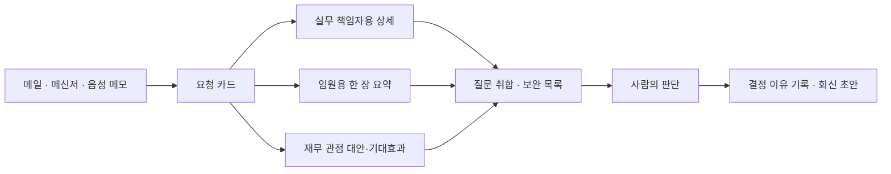

# 💡 아이디어 제안: 예산 요청 수집함 (Budget Request Inbox)

> 1차 아이디어 회의 제출용 · 작성: 임유진 · 작성일: 2026-11-11
> ※ 회사명·부서명·실제 금액·내부 문서는 모두 마스킹했습니다.

---

## 1. 내 업무 (마스킹)

- **업종:** 금융권 기업
- **직무:** 전사 예산 관리 (임원 비서 업무 겸직)
- **하는 일:** 사내에서 진행되는 모든 프로젝트·행사·추진 건 중 **비용이 1원이라도 드는 건**을 관리
  - 이 돈이 필요한지, 투자 대비 효과가 있는지 **판단**
  - 규정 대조·증빙 확인(경리심사)과는 다른 업무. 핵심은 **필요성과 ROI 판단**

## 2. 문제 (Pain Point)

### 2-1. 요청이 형식 없이, 사방에서 들어온다
메일, 메신저, 전화, 복도에서 지나가다 구두로, 회사 앞 커피숍에서 갑자기.
**정해진 양식이 없어서** 판단하기 전에 먼저 기억하고, 모으고, 정리해야 한다.

### 2-2. 의사결정권자가 여러 명이다
같은 요청이라도 보는 사람마다 원하는 자료가 다르다.
- 실무 책임자: 세부 산출 근거, 일정
- 임원: 한 장 요약, 왜 필요한지
- 재무 관점: 대안 비교, 기대효과 측정 방법

→ **같은 내용을 사람마다 다시 정리**하고, 각자 던진 질문을 모아 또 보완한다.

### 2-3. 결정 이유가 남지 않는다
구두로 오간 요청과 결정은 기록이 흩어진다. 나중에 "그때 된다고 하셨잖아요"가 나와도 근거를 찾기 어렵고, 비슷한 요청에 일관된 판단을 하기 어렵다.

> **요약:** 핵심 업무는 "판단"인데, 그 앞의 **수집 → 정리 → 사람별 자료 작성 → 질문 취합 → 기록**이 시간을 다 잡아먹는다.

## 3. 해결 아이디어

**한 줄 요약:** 형식 없이 들어온 예산 요청을 받아 적고, 의사결정권자별 보고 자료로 바꿔주는 도구.  
**원칙:** 정리는 한 번, 보고는 여러 번.

### 3-1. 기능 흐름

### 3-2. 단계별 설명

| 단계 | 입력 | AI가 하는 일 | 결과 |
|---|---|---|---|
| ① 받아 적기 | 메일 전달, 메신저 복붙, **본인이 직접 녹음한 음성 메모** | 요청 내용 구조화 | **요청 카드**: 누가, 무엇을, 왜, 얼마, 언제, 기대효과, 아직 모르는 것 |
| ② 사람별 자료 | 요청 카드 + 의사결정권자 설정 파일 | 보는 사람 기준에 맞춰 재구성 | 실무용 상세 / 임원용 1장 / 재무 관점 자료 |
| ③ 질문 취합 | 의사결정권자들의 질문·코멘트 | 흩어진 질문을 모아 정리 | 보완해야 할 항목 목록 |
| ④ 기록·회신 | 사람의 최종 결정 | 결정 이유 정리, 회신 문구 작성 | 결정 기록 + 요청자 회신 초안 |

### 3-3. 설계 원칙
- **숫자는 코드가, 문장은 AI가.** 금액 합계·비교는 코드로 계산해 숫자 오류(환각)를 막는다.
- **상대방 목소리를 녹음하지 않는다.** 통화·대화 내용은 끝난 뒤 담당자가 직접 요약해 말한 음성 메모만 받는다.
- **의사결정권자 설정은 파일로 분리.** "이 사람은 무엇을 먼저 보는가"를 설정 파일로 관리해, 다른 회사도 설정만 바꿔 쓸 수 있게 한다.

## 4. 인간과 AI의 역할 구분

| AI | 사람 |
|---|---|
| 받아 적기, 구조화 | 필요성 판단 |
| 의사결정권자별 자료 작성 | 투자 대비 효과(ROI) 판단 |
| 질문 취합, 보완 목록 정리 | 승인 · 반려 · 조정 |
| 결정 이유 정리, 회신 초안 | 최종 회신 발송 |

> AI는 **승인·반려를 권하지 않는다.** 판단에 필요한 재료를 정리하는 데까지만 한다.

## 5. 개발 우선순위 (MVP)

1. **받아 적기 → 요청 카드** — 모든 기능의 기반
2. **의사결정권자별 보고 자료** — 가장 큰 시간 절약, 시연 하이라이트
3. **질문 취합 · 결정 기록** — 시간이 남으면 구현, 안 되면 다음 버전 로드맵으로 기록

## 6. 오픈소스 · 시연 계획

- **회사 데이터 사용 안 함.** 가상의 요청 수십 건(신년 행사, 부서 워크숍, 외부 교육 등)과 가상의 의사결정권자 3명(실무 책임자, 담당 임원, 재무 책임자)으로 시연
- **시연 하이라이트:** 같은 요청 하나가 세 사람용 자료로 갈라지는 장면
- **확산 대상:** 형식 없이 비용 요청이 들어오는 모든 조직 — 예산·총무·구매·기획 부서, 공공기관, 소규모 회사 대표

## 7. 본인 회사 업무를 선택했을 때 장단점

### 장점
- 제안자가 **실제 사용자**라 문제 정의가 정확하다
- 형식 없는 요청 + 다단계 결재는 **업종·규모 상관없이** 겪는 문제라 범용성과 홍보 대상이 넓다
- 가상 데이터로도 전체 흐름을 그대로 시연할 수 있다

### 단점과 대응
| 단점 | 대응 |
|---|---|
| 금융권 망분리로 외부 AI 사용이 어려울 수 있음 | **사내 설치형 옵션**(로컬 LLM, 기기 내 음성 인식)을 처음부터 설계 → 보안이 까다로운 금융권·공공기관 대상 차별점으로 전환 |
| 결재 흐름이 회사마다 다름 | 의사결정권자 설정 파일로 분리. 단, 너무 일반화하면 아무 데도 안 맞을 수 있어 기본 템플릿 2~3종 제공 |
| 실제 사내 데이터로 검증 불가 | 가상 데이터 + 실무자(제안자) 검토로 대체, 검토 과정을 깃허브에 기록 |

## 8. 검토했다가 버린 아이디어 (고민 과정 기록)

### 8-1. 전사 예산 총괄 코파일럿 (타 AI 제안)
대형 프로젝트 심의 + 부서별 경상비 잔액 문의 응대를 합친 아이디어. **채택하지 않은 이유:**
- **제품 두 개를 하나로 묶음** — 사용자, 데이터, 기술이 모두 달라 한 학기에 완성도를 내기 어렵다
- **실제 업무와 어긋남** — 단가 이상치·규정 대조는 경리심사 영역. 내 업무의 핵심은 필요성·ROI 판단
- **생성형 AI가 약한 걸 시킴** — 잔액 조회는 ERP·대시보드의 일. 숫자를 한 번만 틀려도 신뢰가 무너진다
- **시연 불가** — "과거 사내 DB와 중복 대조"는 오픈소스라 실제 DB를 쓸 수 없고, 가짜 데이터로는 유용성을 증명할 수 없다
- **AI 절감 권고의 정치성** — 부서 간 배분 협상에서 AI 권고가 도구가 아니라 무기가 될 수 있다
- **금융권 보안 미고려**

### 8-2. 예산 요청서 사전 코치 (1차 자체 아이디어)
기안자가 요청서를 올리기 전에 AI가 빠진 항목을 질문해주는 도구. **채택하지 않은 이유:**
- 정해진 요청 양식이 있다는 전제였으나, **실제로는 양식이 없어** "빠진 항목"이라는 개념 자체가 성립하지 않음
