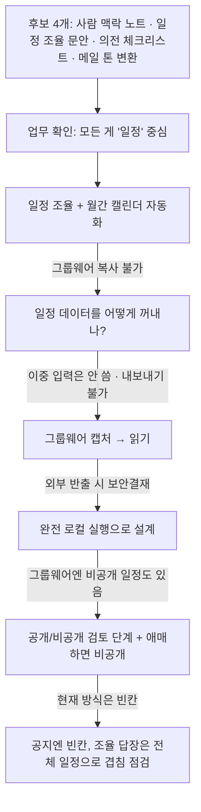
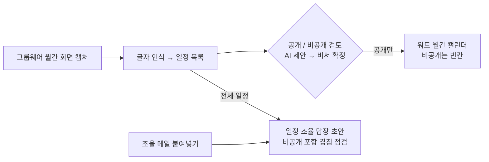

# 💡 아이디어 제안: 임원 일정 코파일럿 (Executive Schedule Copilot)

> 1차 아이디어 회의 제출용 · 작성: 임유진 · 작성일: 2026-11-11
> ※ 회사명·임원 정보·실제 일정은 모두 마스킹했습니다.

---

## 1. 업무 배경 (마스킹)

- **업종:** 금융권 기업
- **직무:** 임원 비서

### 주요 업무
| 업무 | 빈도 | 내용 |
|---|---|---|
| 일정 조율 | **거의 매일** | 메일 대부분이 일정 조율. 부문 외 부서는 보안상 그룹웨어 일정 열람 불가 → 비서가 직접 확인해 회신 |
| 월간 일정 게시 | **매월 1일** | 그 달 일정을 워드 캘린더 양식으로 정리해 부문 전체 공지 |
| 출장 의전 | 수시 | 국내: 기차·숙소·연석·대리기사 배정·출발시각·출장지 주차 정보 안내 / 해외: + 항공편 |
| 전화 응대 | 수시 | 임원 부재 시에만 당겨 받음 |
| 경조사 | 수시 | 사내 게시판 확인 후 임원과 연관 있는 건을 비서가 판단해 전달 |
| 손님 응대 | 수시 | 필요 시 차대 세팅 |

> 회의 준비·보고 자료는 비서가 아닌 실무자 담당.

## 2. 문제 (Pain Point)

### 2-1. 같은 일정을 여러 번 옮겨 적는다
- 그룹웨어 일정표를 전사가 쓰지만, **월간 캘린더를 만들 때 복사·붙여넣기가 안 됨** → 양식부터 수기 기재
- 수기 기재라 **가끔 오타나 틀리는 경우** 발생
- 부문 외 부서는 일정 열람이 안 돼서 **"이날 시간 되세요?" 메일에 비서가 매번 직접 확인 후 회신**

### 2-2. 틀리면 큰일 나는 일들
- **일정 겹침, 식당 예약 실수** → 큰일
- (상대적으로 경조사는 가벼운 편)

### 2-3. 수기 기재 안에 숨은 판단: 공개 / 비공개
그룹웨어에는 워드 캘린더에 **올리지 않는 일정**이 함께 있다.
- 만찬 일정, 비공식 미팅, 운동 일정 등
- 현재는 옮겨 적으면서 비서가 **빼고 빈칸으로 둔다**

→ 자동화할 때 이 판단을 놓치면 **비공개 일정이 부문 전체 공지에 올라가는 사고**가 난다. 오타보다 훨씬 큰 문제.

### 2-4. 임원마다 스타일이 다르다
- 매일 오전 일정 리마인드가 필요한 임원 / 필요 없는 임원
- 구두 보고를 선호하는 임원 / 메신저를 선호하는 임원
- 식사·간식 취향이 다름

### 2-5. 사내망 밖으로 아무것도 못 보낸다
그룹웨어 화면 캡처·PDF 저장은 가능하지만, **사내망 외부 반출 시 보안결재 승인 필요** → 외부 AI 서비스(클라우드)에 일정 캡처를 보낼 수 없다.

## 3. 아이디어 변천 과정 (고민 기록)

## 4. 해결 아이디어

**한 줄 요약:** 그룹웨어 일정을 캡처 한 장으로 읽어서, 부문 공지용 월간 캘린더와 일정 조율 답장을 만들어주는 **완전 로컬** 비서 도구.  
**원칙:** 같은 일정을, 보는 사람에 따라 다르게 내보낸다. 그리고 아무것도 사내망 밖으로 나가지 않는다.

### 4-1. 기능 흐름

### 4-2. 기능 상세

| 기능 | 하는 일 | 결과 |
|---|---|---|
| **① 월간 캘린더 생성** | 그룹웨어 캡처를 글자 인식(OCR)으로 읽어 일정 목록화 → 공개 일정만 워드 캘린더 양식에 자동 기재 | 수기 기재·오타 제거 |
| **② 공개/비공개 검토** | 일정마다 AI가 공개·비공개를 **제안**, 비서가 확정한 뒤에 문서 생성. **애매하면 비공개** | 비공개 일정 유출 방지 |
| **③ 생성 전 점검** | 겹치는 일정, 장소 누락, 시간 누락 알림 | 큰일 나는 실수 예방 |
| **④ 일정 조율 답장 초안** | 조율 메일을 붙여넣으면 누가·무슨 건·희망 시간·소요 시간·장소 추출 → **비공개 포함 전체 일정**과 대조 → 가능한 시간 후보로 답장 초안 | 매일 반복되는 조율 회신 시간 단축 |
| **⑤ 임원별 설정** | 리마인드 여부, 보고 방식(구두 요약 / 메신저 문장), 식사·간식 취향을 설정 파일로 | 결과물이 임원 스타일에 맞춰짐 |
| **⑥ 출장 안내문 (확장)** | 기차·숙소·항공 예약 확인 메일 → 일정표·안내 문구 + 빠진 항목 체크리스트(대리기사, 출장지 주차 등) | 출장 의전 준비 시간 단축 |

### 4-3. 같은 일정, 다른 출력

| 기능 | 보는 사람 | 비공개 일정 |
|---|---|---|
| 월간 캘린더 | 부문 전체 | **빈칸** (현행 방식 유지) |
| 일정 조율 답장 | 비서만 | **포함해서** 겹침 점검 |

> 공지에는 빈칸으로 사생활을 지키고, 누가 빈칸을 보고 미팅을 요청해도 조율 단계에서 비공개 일정과의 겹침을 잡아낸다.

## 5. 인간과 AI의 역할 구분

| AI | 비서 | 임원 |
|---|---|---|
| 캡처 읽기, 일정 목록화 | **공개/비공개 확정** | 바꿀 것 없음 |
| 공개/비공개 제안 | 미팅 우선순위 판단 | 받는 결과물이 스타일에 맞춰질 뿐 |
| 겹침·누락 점검 | 일정 확정 | |
| 캘린더 문서·답장 초안·출장 안내문 작성 | 최종 공지·발송 | |

> AI는 무엇을 공개할지 **결정하지 않는다.** 제안만 하고, 확정은 비서가 한다.  
> 임원의 습관은 바꾸지 않는다. 도구는 비서 쪽에만 붙는다.

## 6. 설계 원칙과 위험 대응

| 위험 | 대응 |
|---|---|
| **비공개 일정이 공지에 노출** | 생성 전 비서 검토 필수. **애매하면 비공개가 기본** → 틀려도 "빠뜨림"(정정 가능) 쪽으로 틀리게 설계 |
| **캡처 읽기 오류** | 생성된 캘린더를 원본 캡처와 나란히 놓고 확인하는 화면 제공 |
| **사내망 외부 반출** | **완전 로컬 실행.** 오픈소스 로컬 AI 모델 사용, 인터넷 연결 없이 동작이 기본. 외부 AI 연결은 개인 시연용 옵션으로만, 기본값은 꺼짐 |
| **회사 PC 사양 부족** | 캡처 읽기는 무거운 AI 대신 글자 인식 + 규칙으로. AI는 메일 읽기·답장 초안 같은 글 작업에만 |
| **사내 PC 프로그램 설치 승인** | 설계로 피할 수 없음 → **보안 검토용 설명서**를 함께 제공해 승인 과정을 돕는다 |
| **이중 입력** | 그룹웨어 외에 별도로 일정을 입력하게 하는 방식은 채택하지 않음 (일이 늘어나는 도구는 안 쓴다) |

## 7. 개발 우선순위 (MVP)

1. **월간 캘린더 생성 + 공개/비공개 검토 + 생성 전 점검** — 매월 실제 수기 작업, 결과물이 눈에 보여 시연 효과가 큼
2. **일정 조율 답장 초안** — 매일 쓰는 기능, 비공개 일정 겹침 점검이 차별점
3. **임원별 설정, 출장 안내문** — 시간이 남으면 구현, 아니면 로드맵으로 기록

## 8. 오픈소스 · 시연 · 확산 계획

- **가상 데이터:** 가상의 임원 2~3명, 가상의 그룹웨어 월간 화면 캡처(공개·비공개 일정 섞어서), 가상의 조율 메일
- **시연 하이라이트:** 캡처 한 장 → 비공개 일정(만찬·운동)이 자동으로 걸러진 부문 공지용 캘린더 완성
- **보안 검토용 설명서 동봉:** 데이터가 어디서 들어와 어디에 저장되고, **외부로는 한 번도 나가지 않는다**는 흐름도 한 장. 다른 회사 비서가 그대로 보안 담당자에게 제출할 수 있게
- **확산 대상:** 외부 AI 사용이 막힌 금융권·공공기관·대기업의 임원 비서, 비서실, 총무
- **홍보 포인트:** "외부로 아무것도 안 나가는 비서 도구" — 대부분의 AI 도구는 클라우드로 데이터를 보내서 이런 조직에선 쓸 수 없다

## 9. 검토했다가 버린 · 보류한 아이디어

| 아이디어 | 결정 | 이유 |
|---|---|---|
| 사람 맥락 노트 (미팅 상대 브리핑) | ⏸ 보류 | 인물 정보가 민감하고, 일정 문제보다 빈도가 낮음 |
| 메일·부탁 글 톤 변환 | ❌ 폐기 | 이미 범용 AI로 하고 있어 차별점이 약함 |
| 경조사 알림 | ❌ 폐기 | 상대적으로 가볍고, 임원과의 연관성 판단은 사람 몫 |
| 손님 응대 | ❌ 폐기 | 물리적 업무 비중이 큼 |
| 확정 시 도구에도 일정 입력 | ❌ 폐기 | 그룹웨어와 **이중 입력** → 일이 늘어나는 도구는 안 쓴다 |
| 외부 AI(클라우드)로 캡처 읽기 | ❌ 폐기 | 사내망 외부 반출 시 보안결재 필요 |
| 비공개 일정을 "외부 일정"으로 표시 | ❌ 폐기 | 현재 방식은 빈칸. 시간만 막아도 "뭔가 있다"는 사실이 드러남. 공지 양식 변경은 조직이 정할 일 |

## 10. 본인 업무를 선택했을 때 장단점

### 장점
- 매월·매일 반복되는 **실제 수기 작업**을 줄이는 명확한 효과
- 일정 조율·일정 공유는 **어느 회사 비서든 하는 일** → 범용성 높음
- 캡처 방식이라 **그룹웨어 종류와 무관**하게 사용 가능
- "외부 반출 없음"이 금융권·공공기관 대상 **차별점**

### 단점
- 로컬 AI는 클라우드 AI보다 성능이 낮음 → 글 작업 품질 한계
- 그룹웨어마다 화면 형식이 달라 **캡처 읽기 규칙을 그룹웨어별로 맞춰야** 함
- 사내 PC 설치 자체가 승인 대상일 수 있어 **실제 사내 도입은 불확실**

## 11. 다음 회의 논의 사항
- [ ] 세 아이디어 비교 · 최종 선정 (아래 비교표 참고)
- [ ] 개발 형태 결정 (웹 / 앱 / TUI)
- [ ] 로컬 AI 모델 후보 조사 및 팀원 PC 사양 확인
- [ ] 가상 그룹웨어 캡처 · 가상 메일 데이터셋 설계

---

## 📊 세 아이디어 비교

| 항목 | ① 예산 요청 수집함 | ② GA 관리자 판단 코파일럿 | ③ 임원 일정 코파일럿 |
|---|---|---|---|
| **핵심 문제** | 형식 없이 사방에서 들어오는 예산 요청, 여러 의사결정권자용 자료 반복 작성 | 설계사의 예외 요청과 "누구는 해줬다" 선례 압박 | 같은 일정을 여러 번 옮겨 적기, 공개/비공개 판단, 보안 반출 제약 |
| **주 사용자** | 전사 예산 담당자 | 원수사 GA 관리자 | 임원 비서 |
| **핵심 인사이트** | 양식이 없다 → 판단 앞의 정리가 병목 | 이미 챗봇이 있는데 안 씀 → 설계사는 안 바뀐다 | 수기 기재 안에 공개/비공개 판단이 숨어 있다 |
| **생성형 AI 적합도** | 높음 (비정형 요청 정리, 사람별 자료 작성) | 높음 (문서 근거 답변, 선례 설명) | 중간~높음 (캡처 읽기는 OCR 위주, 메일·답장은 AI) |
| **시연 데이터** | 가상 요청 + 가상 의사결정권자 | **공개 약관(실제 문서)** + 가상 선례 | 가상 캡처 + 가상 메일 |
| **범용성 · 홍보 대상** | 예산·총무·구매·기획, 공공기관 | **원수사·GA 업계 전체** | 금융·공공·대기업 비서, 비서실 |
| **주요 위험** | 망분리, 결재 흐름의 회사별 차이 | 불완전판매, 설계사 감시화, 관리자 이해충돌 | 비공개 일정 노출, 로컬 AI 성능, PC 설치 승인 |
| **시연 하이라이트** | 요청 하나가 세 사람용 자료로 갈라짐 | "누구는 해줬다는데요?" → 선례 기반 답변 | 캡처 한 장 → 비공개가 걸러진 공지 캘린더 |
| **MVP 구현 난도** | 중간 | 중간~높음 (문서 검색 + 선례 검색) | **낮음~중간** (OCR + 문서 생성이 중심) |
| **사용자 검증 방법** | 제안자 본인 검토 | 실제 GA 관리자 인터뷰 필요 | 제안자 본인 검토 + 다른 비서 의견 |
