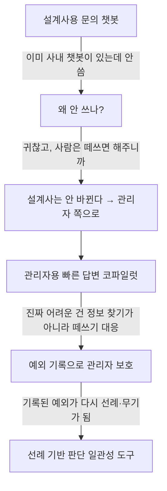
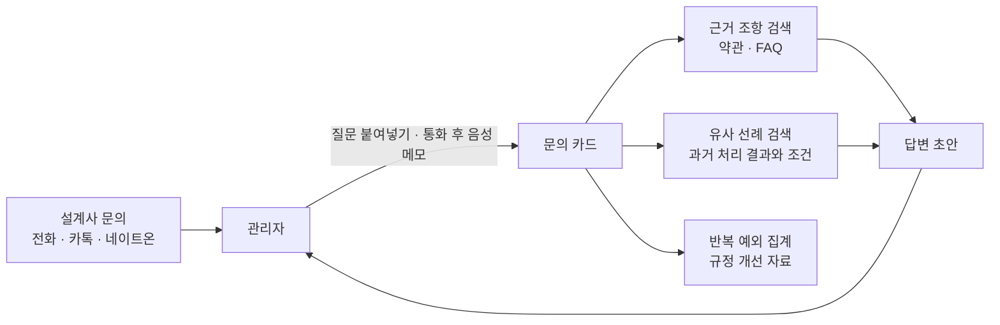

# 💡 아이디어 제안: GA 관리자 판단 코파일럿 (GA Manager Copilot)

> 1차 아이디어 회의 제출용 · 작성: 임유진 · 작성일: 2026-11-11
> ※ 회사명·실제 규정·수수료 체계·내부 문서는 모두 마스킹했습니다.

---

## 1. 업무 배경 (마스킹)

- **업종:** 보험업 (원수사)
- **직무:** GA(법인보험대리점) 관리자
- **규모:** 관리자 1명당 평균 **약 100개 지사, 설계사 약 7,000~9,000명** 관리

### 주요 업무
| 업무 | 내용 |
|---|---|
| 상품 안내 | 매월 신상품 교육 및 안내 |
| 매출 관리 | 관리자별 매출 목표 달성, 지점 간 경쟁 구도 |
| 설계사 관리 | 고객과 계약 진행 중 생기는 문의·문제 대응 |
| 수수료·전산 | 수수료 관리, 전산 배부, 유의계약 관리, 모니터링 확인 등 |
| 원본 서류 확인 | 설계사가 등기로 보낸 계약 서류 원본의 누락·이상 확인 후 문서고 이관 (직접 확인·포장·발송) |

> 한 줄 요약: **일이 너무 많다.**

## 2. 문제 (Pain Point)

### 2-1. 문의가 끝없이, 사람에게 온다
- 문의 유형은 **상품 · 절차 · 수수료가 비슷한 비율**
- 채널은 **전화, 외부 메신저(카카오톡, 네이트온)**

### 2-2. 이미 설계사용 사내 챗봇이 있다. 하지만 아무도 안 쓴다
- **몰라서가 아니라 귀찮아서**
- **사람이 편해서**
- **사람은 안 될 것도 떼쓰고 욕하면 해주니까**

→ 설계사가 관리자에게 원하는 건 **정보가 아니라 예외**다. 챗봇은 규정대로만 답하기 때문에, 아무리 똑똑해져도 쓰이지 않는다.

### 2-3. 한 번 들어준 예외가 선례가 되어 돌아온다
- "**누구는 해줬다는데 왜 전 안 돼요?**"
- "**저번에도 해줬으니 또 해주세요**"

→ 예외가 다음 떼쓰기의 무기가 되고, 관리자마다 기준이 달라 설계사는 관리자끼리 비교한다.

### 2-4. 관리자도 예외를 들어줄 동기가 있다
관리자에게도 매출 목표와 지점 간 경쟁이 있다. 설계사의 예외를 들어주면 그 계약이 관리자 실적이 된다. **"규정대로 막아주는 AI"는 관리자도 쓰지 않을 수 있다.**

## 3. 아이디어 변천 과정 (고민 기록)

| 단계 | 처음 | 최종 |
|---|---|---|
| 대상 | 설계사용 챗봇 | **관리자용 코파일럿** |
| 문제 정의 | 문의가 많다 | 설계사는 안 바뀌고, 관리자가 예외 요청과 선례 압박을 받아낸다 |
| 핵심 기능 | 빠른 답변 | **선례 기반 일관된 판단 + 예외 기록 + 반복 예외 집계** |
| 가치 | 시간 절약 | **일관성, 관리자 보호, 규정 개선** |

## 4. 해결 아이디어

**한 줄 요약:** 설계사는 지금처럼 관리자에게 연락하고, 관리자는 AI로 근거와 선례를 찾아 일관되게 판단한다.  
**원칙:** 예외를 막지 않는다. 예외의 흔적이 남게 한다.

### 4-1. 기능 흐름

### 4-2. 기능 상세

| 기능 | 하는 일 | 효과 |
|---|---|---|
| **문의 카드** | 붙여넣은 메신저 질문, 통화 후 **관리자 본인의 음성 메모**를 구조화 | 흩어진 문의를 한 곳에 |
| **근거 조항 검색** | 약관·상품설명서·승인된 FAQ에서 근거를 찾아 제시 | "개인 판단"이 아니라 "규정"을 근거로 설명 |
| **유사 선례 검색** | 비슷한 과거 예외 요청과 처리 결과·조건을 보여줌 | "누구는 해줬다" → "그때는 이 조건이 있었다"로 설명. 소문이면 "그런 처리 없었다" 확인 |
| **답변 초안** | 근거와 선례를 반영한 답변 문안 작성 | 관리자는 확인·수정 후 발송 |
| **예외 기록** | 예외 요청과 처리, 사유, 결재 여부를 카드로 남김 | 나중에 유의계약 등으로 문제 돼도 처리 근거가 남음 |
| **반복 예외 집계** | 자주 들어오는 예외 요청을 **유형별**로 묶어 보고 | 반복되는 예외 = 규정이 현실과 안 맞을 가능성 → 규정 개선 제안 자료 |
| **신상품 변경점 요약** | 이전·신규 상품설명서를 비교해 바뀐 점 정리 | 월별 교육 자료 작성 시간 단축 |

### 4-3. 문의 유형별 처리

| 문의 유형 | AI | 관리자 |
|---|---|---|
| 상품 | 약관·상품설명서 근거로 답변 초안 | 확인 후 발송 |
| 절차 | 승인된 FAQ 근거로 답변 초안 | 확인 후 발송, FAQ 승인 |
| 수수료 | **답하지 않음.** 문의 내용만 정리 | 정산 시스템 확인 후 직접 답변 |
| 예외 요청 | 근거 조항 + 유사 선례 + 답변 초안 | 판단, 필요 시 정식 결재로 상향 |

> 수수료는 개인별 금액(정산 데이터 필요)과 회사별 규정(영업비밀)이라 범위에서 제외. **AI 답변 대상은 전체 문의의 약 3분의 2**로 명시.

## 5. 인간과 AI의 역할 구분

| AI | 사람(관리자) |
|---|---|
| 문의 정리, 근거 조항 검색 | 예외 승인 · 거절 판단 |
| 유사 선례 검색, 답변 초안 | 최종 답변 발송 |
| 예외 기록 정리, 반복 유형 집계 | 정식 결재 상향, 규정 개선 제안 |

> AI는 **승인·거절을 결정하지 않는다.** 판단 근거와 선례를 정리하는 데까지만 한다.  
> 설계사는 **아무것도 바꿀 필요가 없다.** 지금처럼 관리자에게 연락하면 된다.

## 6. 설계 원칙과 위험 대응

| 위험 | 대응 |
|---|---|
| **틀린 답 → 불완전판매** | 문서에 있는 것만 답하고 근거 조항 필수 표시. 답변은 AI가 직접 보내지 않고 관리자가 확인 후 발송. 인수 심사 판단은 하지 않음 |
| **설계사 감시 도구화** | 기록·집계는 **요청 유형 단위**로만. 설계사 개인별 점수·순위는 만들지 않음 |
| **관리자의 이해충돌** (예외 = 내 실적) | 예외를 막지 않음. 대신 기록이 남아 나중에 문제 돼도 관리자를 보호 → 관리자가 쓸 이유가 생김 |
| **상대방 목소리 녹음** | 통화 녹음 안 함. 통화 후 관리자 본인의 음성 메모만 받음 |
| **선례 기록이 다시 무기가 됨** | 선례는 관리자 내부용. 설계사에게 원문 공개하지 않고, "조건"과 함께 설명하는 데만 사용 |
| **금융권 망분리** | 사내 설치형 옵션(로컬 LLM) 설계 |

## 7. 개발 우선순위 (MVP)

1. **문의 카드 + 근거 조항 검색 + 답변 초안** — 기본 기능, 공개 약관으로 바로 시연 가능
2. **예외 기록 + 유사 선례 검색** — 이 아이디어의 차별점
3. **반복 예외 집계 + 신상품 변경점 요약** — 시간이 남으면 구현, 아니면 로드맵으로 기록

## 8. 오픈소스 · 시연 계획

- **공개 문서 활용:** 보험 약관·상품설명서는 각 보험사 홈페이지와 보험협회 공시실에 공개되어 있어, 회사 정보 없이 실제 문서로 시연 가능
- **가상 데이터:** 가상의 설계사 문의, 가상의 예외 요청과 처리 선례
- **시연 하이라이트:** "누구는 해줬다는데요?" 문의 → 유사 선례 검색 → "그때는 이 조건이 있었고, 이번엔 다르다" 답변 초안
- **확산 대상:** 모든 원수사 GA 관리자, GA 본사 교육·지원 조직, 지점장

## 9. 검토했다가 버린 · 보류한 아이디어

| 아이디어 | 결정 | 이유 |
|---|---|---|
| 설계사용 문의 챗봇 | ❌ 폐기 | **이미 사내 챗봇이 있는데 안 쓴다.** 설계사가 원하는 건 정보가 아니라 예외라서, 더 똑똑한 챗봇도 안 쓸 것 |
| 매출 관리 AI | ❌ 폐기 | 숫자 집계·순위는 대시보드의 일. 생성형 AI를 쓸 이유가 약함 |
| 수수료 문의 자동 응답 | ❌ 폐기 | 개인별 정산 데이터 필요, 규정은 영업비밀. 숫자 오류 시 분쟁 |
| 원본 서류 사전 점검 | ⏸ 보류 | 설계사가 발송 전 스캔해 서명 누락·빈칸을 미리 잡는 아이디어. 앞단에서 반송을 줄일 수 있지만, 주민번호·건강정보 등 개인정보 부담이 크고 전자청약 확대로 효과가 줄어듦 |

## 10. 본인 업무를 선택했을 때 장단점

### 장점
- 실제 업무 현장의 **"왜 챗봇을 안 쓰는가"**라는 구체적 인사이트에서 출발
- 공개 약관으로 **실제 문서 기반 시연** 가능
- 원수사·GA 업계 전체가 같은 구조라 **범용성과 홍보 대상이 넓음**
- "AI가 사람을 대체하지 않고, 사람의 유연한 판단에 흔적과 일관성을 더한다"는 점에서 **과목 주제와 정확히 맞음**

### 단점
- 선례 데이터는 회사 내부 정보라 **실제 데이터로 검증 불가** → 가상 데이터 + 실무자 인터뷰로 보완
- 관리자의 이해충돌 때문에 **실제 도입 의지가 불확실** → 사용자 인터뷰로 확인 필요
- 금융권 보안으로 사내 적용이 어려울 수 있음

## 11. 사용자 조사 계획

실제 GA 관리자에게 아래 질문으로 짧은 인터뷰를 진행하고 결과를 깃허브에 기록한다.

- [ ] 예외를 들어줬다가 나중에 문제가 된 적이 있는가?
- [ ] 그때 처리 기록이 있었다면 도움이 됐을까?
- [ ] "누구는 해줬다"는 말을 얼마나 자주 듣는가? 실제로 확인해본 적이 있는가?
- [ ] 같은 유형의 예외 요청이 반복되는가? 그게 규정 문제라고 느낀 적이 있는가?
- [ ] 이런 도구가 있다면 쓸 것인가? 안 쓴다면 왜인가?

## 12. 다음 회의 논의 사항
- [ ] 예산 요청 수집함 아이디어와 비교 · 최종 선정
- [ ] 사용자 인터뷰 진행 여부 및 담당
- [ ] 개발 형태 결정 (웹 / 앱 / TUI)
- [ ] 사용할 LLM 결정 (외부 API vs 로컬 LLM)
- [ ] 가상 데이터셋 설계 (문의 유형, 예외 요청, 선례)
